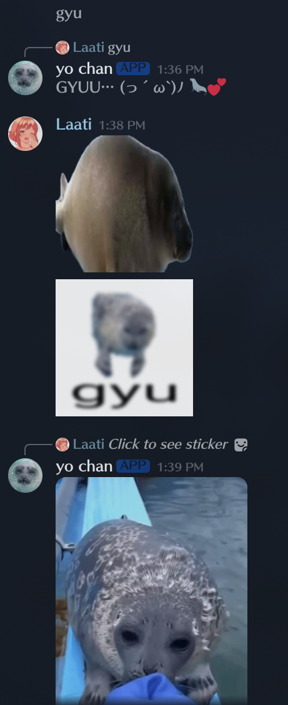
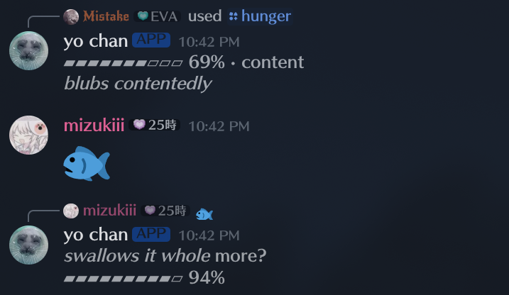
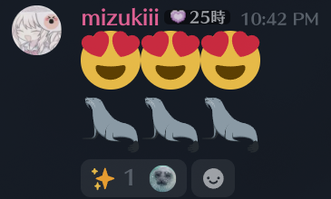

# yo-chan bot

A Discord bot that acts like Yo-chan, the ringed seal from the Okhotsk Tokkari Center. She gyus back, replies to seal posts with Yo-chan media, reacts to sea emoji, and gets hungry if nobody feeds her fish

## What she does

| You do | She does |
| --- | --- |
| Say `gyu`, `gyuuuu`… | Gyus back. More u's make a longer gyu, with random kaomoji, actions, and the odd sassy line. |
| React 🇬 🇾 🇺 in that order on any message | Replies to it with a gyu |
| Post a seal sticker, attachment or GIF link | Replies with a random Yo-chan gif, photo or sticker. Plain text "seal" doesn't count. |
| Send 🦭 🐟 💧 🌊 🫧 and friends | Half the time she reacts to your message |
| Send fish (🐟 🐠 🐡 🍣 🦐 🦑) or react with one on her message | Eats it (see below) |
| `/hunger` | Shows her hunger meter with a comment for her level |

Every reply has a 1 second cooldown per channel. She ignores other bots and DMs

### Hunger

- Starts at 70% and drains to 0 over 12 hours
- Levels: full (80%+), content (50%+), peckish (25%+), hungry (10%+), starving
- Each fish fills her 25%, up to 4 fish per message. Over 95% she refuses
- When she's hungry or starving, about a third of her gyus turn into complaints
- When she drops to hungry, and again at starving, she complains once in the last channel she talked in

### Reactions

## Running

Needs Python 3.11 Invite permissions: View Channels, Send Messages, Embed Links, Attach Files, Read Message History, Add Reactions (`permissions=117824`), & `applications.commands` scope for `/hunger`

Files in `media/` (png, jpg, gif, webp, mp4, webm, mov) are things she replies with

## Deploying

She runs as a systemd user service on a home server

Setup: run `~/yochan-bot/setup.sh`, put `DISCORD_TOKEN=...` in `~/yochan-bot/.env`, then `systemctl --user start yochan-bot`. Logs: `journalctl --user -u yochan-bot -f`
